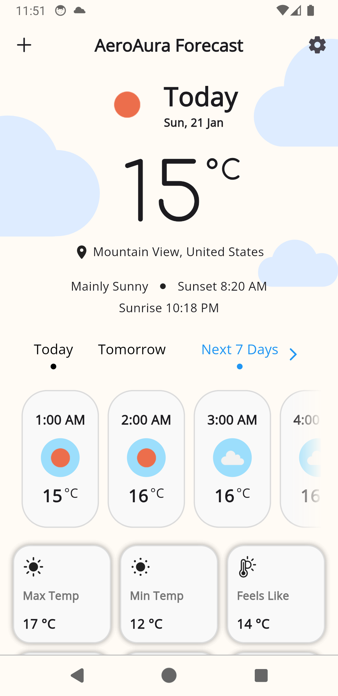
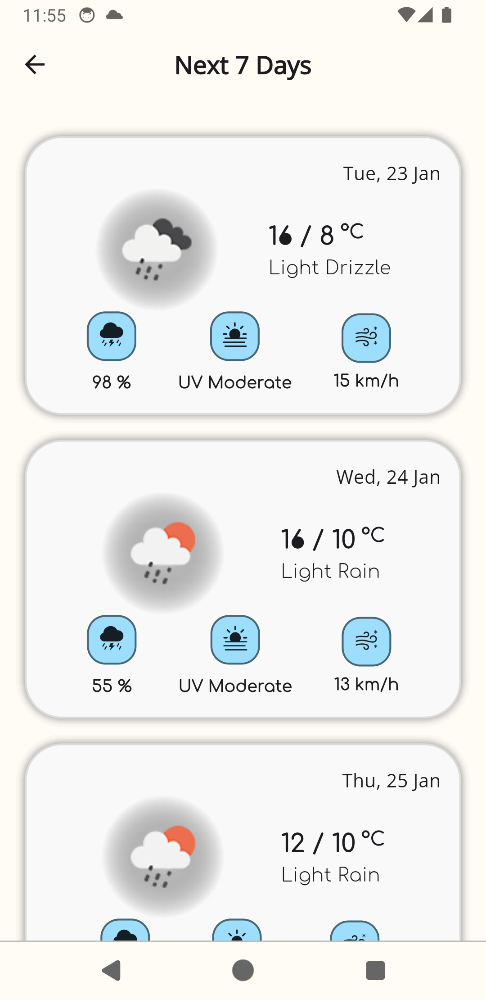
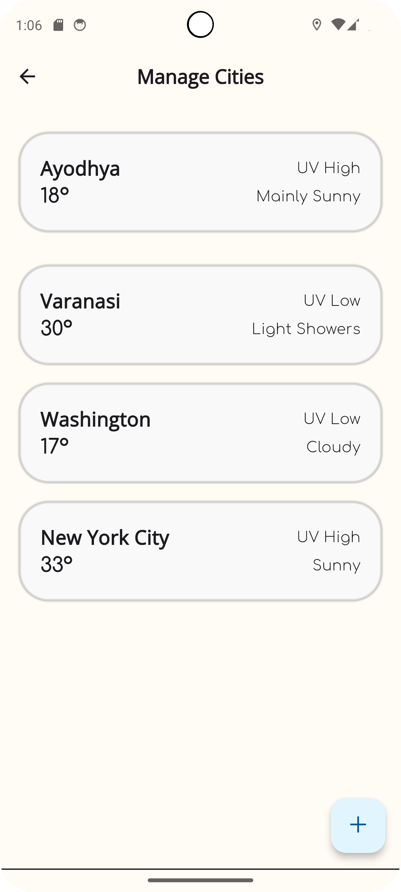
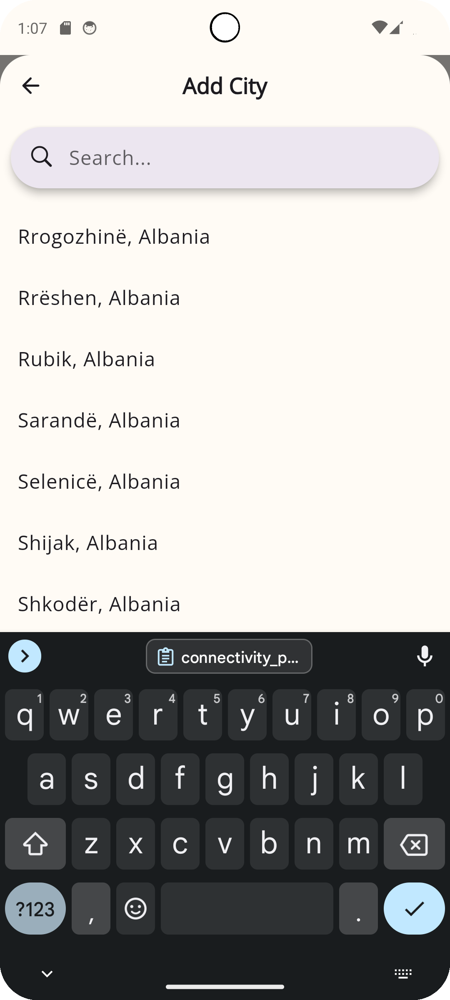
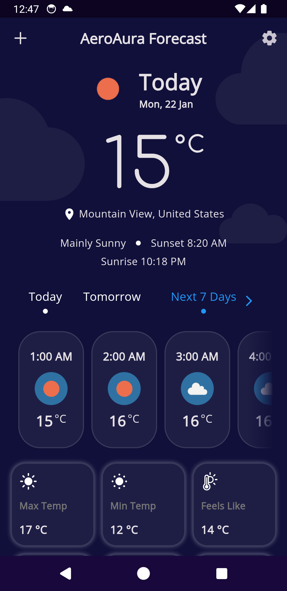
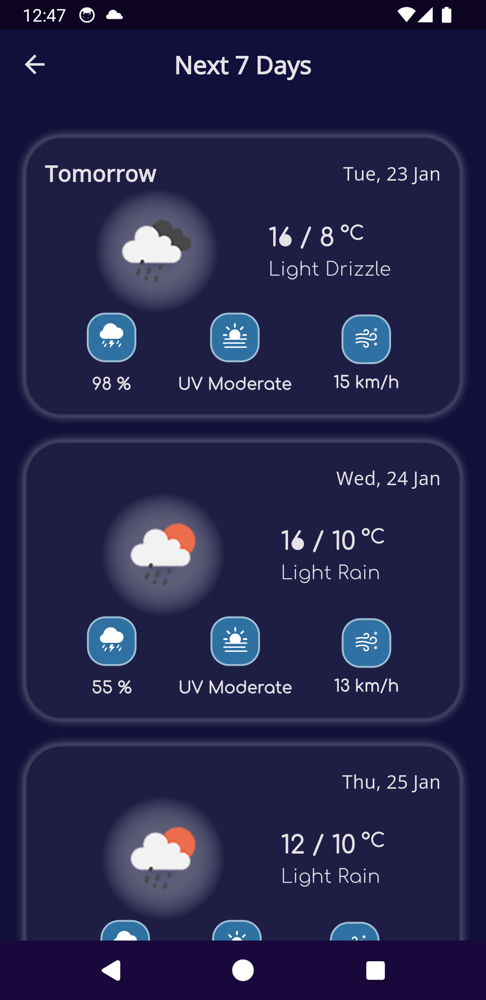
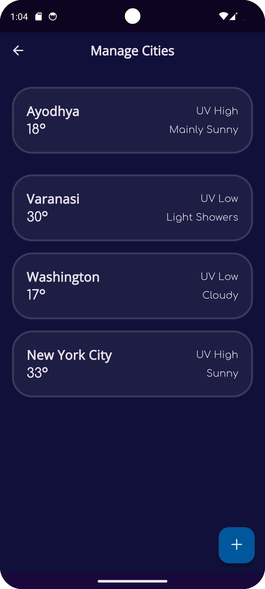
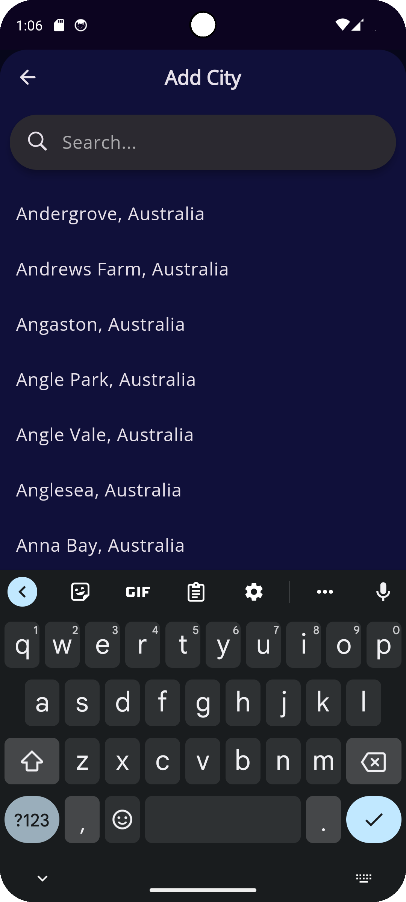
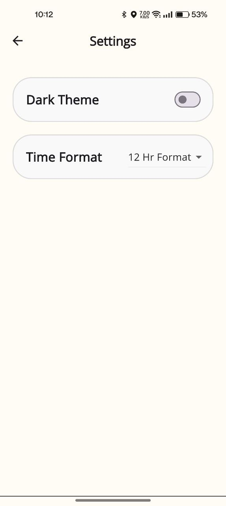
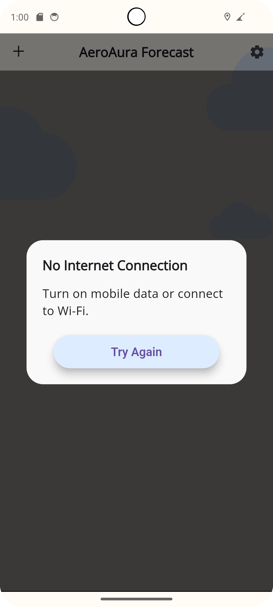

<div align="center">
   
   <h1>Aero Aura - Unleash the Weather</h1>
</div>
<div align="center">


[](./LICENSE)

</div>

<p align='center'>Flutter weather app for Android with real-time conditions, hourly forecasts and a 7-day outlook for any city.</p>

> Based on [AeroAura](https://github.com/Gaurav-Kushwaha-1225/AeroAura) by Gaurav Kushwaha, used under the MIT License.

### 🌍 Features

- 🌟 **Current Weather:** real-time conditions for your location
- 🌅 **Hourly Forecast:** plan your day hour by hour
- 📆 **7-Day Forecast:** week-long outlook
- 🌡️ **Detailed Metrics:** in-depth weather statistics
- 🌆 **City Management:** search and save multiple cities
- ⚙️ **Settings:** Celsius/Fahrenheit, 12h/24h time format, light/dark theme toggle
- 📡 **Connectivity Checker:** handles offline state gracefully
- 💥 **Auto Theme:** follows device theme mode

###  Download APK

- [app-arm64-v8a-release](readme_assets/app-arm64-v8a-release.apk)
- [app-armeabi-v7a-release](readme_assets/app-armeabi-v7a-release.apk)
- [app-x86_64-release](readme_assets/app-x86_64-release.apk)

### 🛠️ My Changes

<!-- List only what you actually built or modified -->
- 
- 
- 

### 🌐 Data Sources

Weather from [Open-Meteo](https://open-meteo.com/en/docs) and city lookup from [Open-Meteo Geocoding API](https://open-meteo.com/en/docs/geocoding-api).

### 🧱 Tech Stack

Flutter, Dart, Provider, GoRouter, REST APIs, SharedPreferences, SQLite (sqflite)

### ⚒️ Dependencies

<details>
<summary>Click to expand</summary>

* [http](https://pub.dev/packages/http)
* [geolocator](https://pub.dev/packages/geolocator)
* [geocoding](https://pub.dev/packages/geocoding)
* [intl](https://pub.dev/packages/intl)
* [go_router](https://pub.dev/packages/go_router)
* [page_transition](https://pub.dev/packages/page_transition)
* [shared_preferences](https://pub.dev/packages/shared_preferences)
* [sqflite](https://pub.dev/packages/sqflite)
* [provider](https://pub.dev/packages/provider)
* [country_state_city](https://pub.dev/packages/country_state_city)
* [connectivity_plus](https://pub.dev/packages/connectivity_plus)

</details>

### 📷 Screenshots

|       |       |       |       |
|-----------------------------------------------|----------------------------------------------|---------------------------------------------|------------------------------------------------|
|  |  |  |  |
|         |   |  |  |

### 🚀 Run Locally

```bash
git clone https://github.com/ayush-patel1/AeroAura.git
cd AeroAura
flutter pub get
flutter run
```

### ☑️ Roadmap

- [ ] Flexible measurement units (wind speed, precipitation, pressure)
- [ ] Presentation video

### 📂 Directory Structure

```
|-- lib
|   |-- models
|   |   |-- location.dart
|   |   |-- weather.dart
|   |-- screens
|   |   |-- add_city_page
|   |   |-- home
|   |   |-- next_7_days
|   |   |-- search_city_page
|   |   |-- settings_page
|   |-- services
|   |   |-- location_service.dart
|   |   |-- weather_service.dart
|   |-- utils
|   |-- widgets
|   |-- main.dart
|-- pubspec.yaml
```

### 📃 License

MIT License. See [LICENSE](./LICENSE). Original copyright belongs to Gaurav Kushwaha; keep his notice in the LICENSE file.

### 👨🏻‍💻 Connect

[LinkedIn](https://www.linkedin.com/in/ayush-patel05) | [GitHub](https://github.com/ayush-patel1) | [Portfolio](https://ayush-patel-dev.vercel.app/)