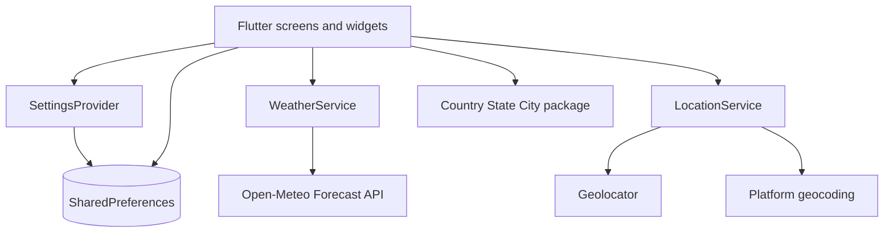

# Aero Aura

Aero Aura is a Flutter weather app for checking current conditions, hourly weather, and a seven-day forecast for the device location or saved cities. It uses Open-Meteo's public forecast API and does not require an API key.

## Features

- Current conditions, weather description, sunrise and sunset, and weather metrics.
- Hourly and daily forecasts, including temperature, precipitation, wind, and UV data.
- Search for and save cities; their coordinates are stored locally.
- Celsius/Fahrenheit, 12/24-hour time, and light/dark theme preferences.
- Connectivity checks and a small local cache of the last displayed conditions.

## Project Details

- **Framework:** Flutter; minimum declared Dart SDK is 3.1.1.
- **State:** Provider is used for settings; forecast data is loaded by screen-level futures.
- **Navigation:** GoRouter.
- **Network and location:** `http`, Open-Meteo, Geolocator, and platform geocoding.
- **Local persistence:** SharedPreferences stores settings, saved-city coordinates, and limited home-screen fallback values.
- **No backend or database:** there is no authentication, server, migration, or database schema in this repository. `sqflite` is declared but is not used by the current Dart source.

## Architecture



`main.dart` initializes settings and routes. The home screen fetches device coordinates and a reverse-geocoded city, then requests current, hourly, and daily data. Saved cities retain coordinates in SharedPreferences and use the same weather service. Requests let Open-Meteo determine the timezone from the coordinates so forecast times are location-specific.

## Local Setup

Install Flutter with Dart 3.1.1 or newer, then run:

```bash
flutter pub get
flutter run
```

No `.env` file or secret values are required. Location access is needed for device-location weather. Saved-city lookups and forecasts require network access.

## Development Checks

```bash
flutter analyze
flutter test
dart format --output=none --set-exit-if-changed lib test
```

Tests cover forecast request construction, geographic coordinate bounds, HTTP failures, malformed responses, timeouts, and the empty saved-city first-run state. Run these checks in an installed Flutter environment before treating them as passing.

## API

The app calls `GET https://api.open-meteo.com/v1/forecast` with latitude and longitude, current/hourly/daily weather fields, `timezone=auto`, and a 24-hour hourly forecast window. The API is public and no application credential is configured. See the [Open-Meteo Forecast API documentation](https://open-meteo.com/en/docs).

City search uses bundled city data from `country_state_city`; reverse geocoding is provided by the platform through `geocoding`. There is no application-owned REST API.

## Build and Deployment

For a local Android release build:

```bash
flutter build apk --release
```

The Android release configuration currently uses debug signing and the application ID `com.example.aeroaura`; configure a unique ID and production signing credentials before publishing. iOS builds require macOS and Xcode signing. Platform deployment has not been verified in this environment.

Previously generated APKs are retained under [`readme_assets`](readme_assets/). They are existing artifacts and do not demonstrate that the current source builds.

- [ARM64 APK](readme_assets/app-arm64-v8a-release.apk)
- [ARMv7 APK](readme_assets/app-armeabi-v7a-release.apk)
- [x86_64 APK](readme_assets/app-x86_64-release.apk)

## Known Limitations

- Flutter is not installed in the current audit environment, so tests, analysis, and builds could not be run here.
- Weather requests have a 15-second timeout and typed transport/API/payload errors; the home and saved-city screens show retry actions. Device-location failures still use a generic message.
- A missing saved-city preference now renders an empty state, and malformed coordinates render an error state; invalid stored entries are not automatically repaired or removed.
- Location permission handling is duplicated between weather and location services.
- Offline support caches a few home-screen values, not forecast data.
- `sqflite` and `page_transition` are declared but do not appear in current Dart imports; verify dependency resolution and platform builds before removing them.
- Existing platform and Flutter plugin versions have not been upgraded as part of this audit.

## Credits and Attribution

The existing Git history credits Ayush Patel from the initial commit onward, with subsequent commits documenting UI changes, bug fixes, and light/dark theme support. The existing MIT license names Gaurav Kushwaha as copyright holder; commit authorship and license copyright are distinct, and the original notice is preserved. This revision adds location-aware forecast requests, coordinate validation, and request-contract tests. Project maintainer details:

- **Ayush Patel**, B.Tech in Information Technology, National Institute of Technology, Raipur (NIT Raipur), expected graduation 2027.
- [GitHub](https://github.com/ayush-patel1) · [Portfolio](https://ayush-patel-dev.vercel.app/)

This documentation describes the code in this repository; it does not claim third-party libraries, APIs, or inherited components as original work. Weather data is from [Open-Meteo](https://open-meteo.com/). Packages retain their respective licenses and notices. This repository is distributed under the [MIT License](LICENSE); retain its existing copyright and license text.

## Screenshots

| Light | Dark |
| --- | --- |
|  |  |
|  |  |
|  |  |
|  |  |

## License

MIT. See [LICENSE](LICENSE).